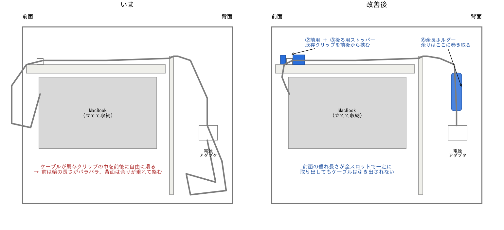
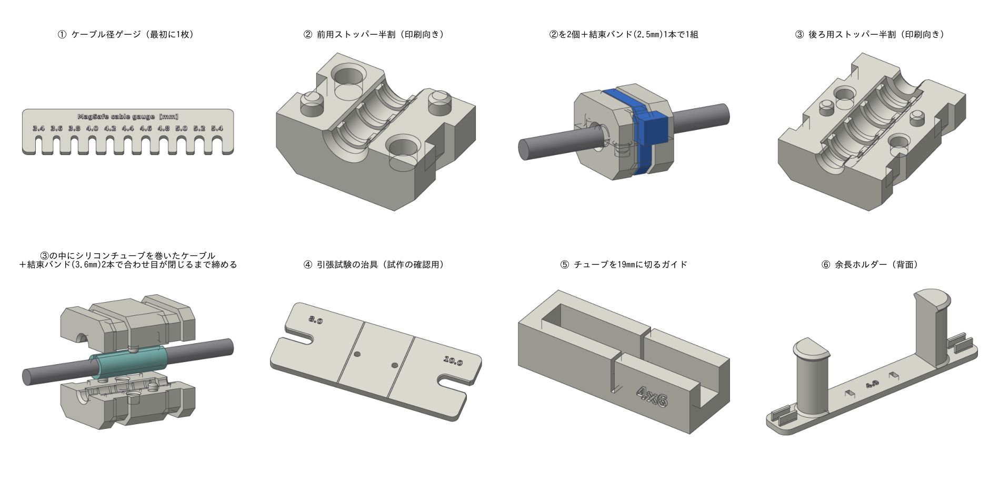
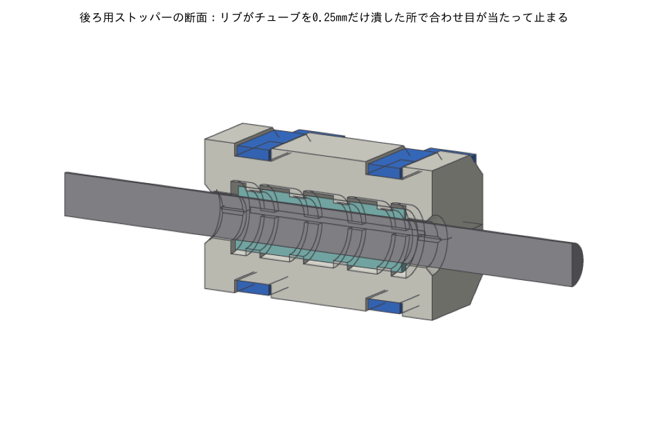
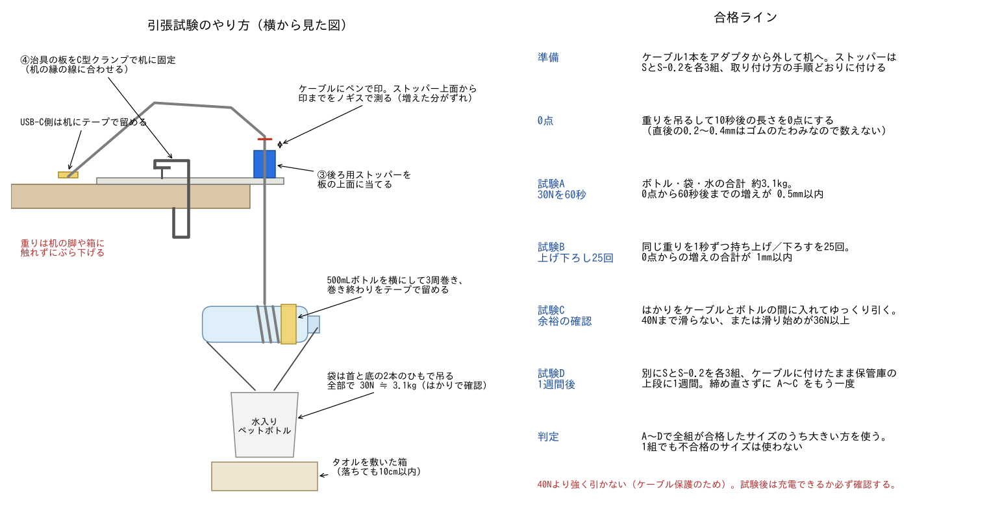
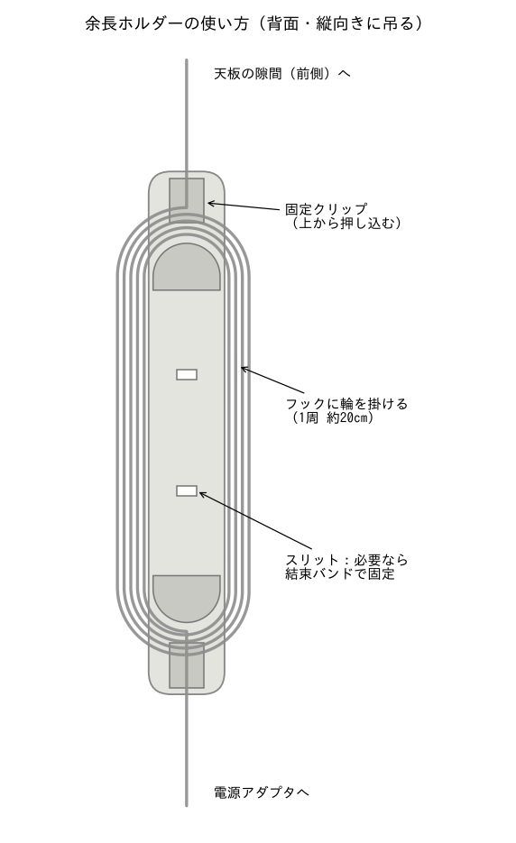
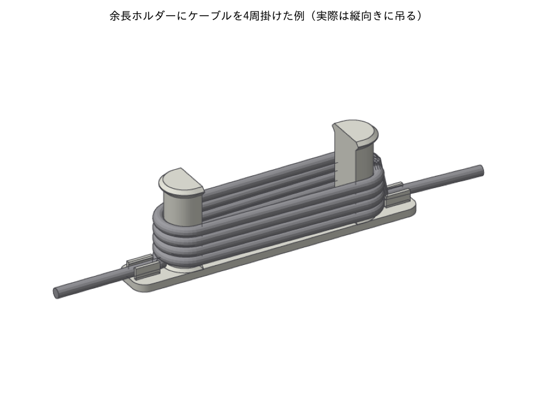

# MacBook充電保管庫のケーブル整理パーツ

充電保管庫の **前面でケーブルの垂れ長さがバラバラになる問題** と **背面で余ったケーブルが垂れて絡まる問題** を、3Dプリント部品で解決するためのデータ一式です。保管庫に穴を開けたり既存部品を外したりはしないので、結束バンドを切ればいつでも元に戻せます。



## なぜバラバラになるのか

MagSafe 3ケーブルは2mあり、アダプタからMacBookまでの経路（背面→天井の配線トレイ→前面）より1m前後長くなります（写真からの目測）。前面の白いクリップはケーブルを **左右には** 押さえていますが、**前後方向には何も止めていない** ので、余った1mが前と後ろを行き来します。

- MacBookを取り出すとき、ケーブルごと手前に引き出される
- 戻すときに引き出した分は戻らないので、前面の輪の大きさがスロットごとに違ってくる
- 背面ではケーブルの余りに定位置がないので、垂れ下がって隣のケーブルと絡む

対策はこの仕組みの裏返しで、**(1) 前面のクリップの位置でケーブルを前後に固定する**、**(2) 余った分は背面でまとめる**、の2つです。背面だけで固定しても、トレイ内にたるみがあれば前面の長さは決まらないので、固定点は前面クリップのところに置きます。

## 部品



| # | 部品 | ファイル | 用途 |
|---|---|---|---|
| ① | ケーブル径ゲージ | `stl/cable_gauge.stl` | ケーブルの太さを測ってサイズ S を決める |
| ② | 前用ストッパー | `stl/d<S>/stopper_front_half_d<S>.stl` | 既存クリップの **前** に付ける小型品。半割2個＋結束バンド(2.5mm幅)1本で1組 |
| ③ | 後ろ用ストッパー | `stl/d<S>/stopper_rear_half_d<S>.stl` | 既存クリップの **後ろ（庫内側）** に付ける主役。半割2個＋シリコンチューブ19mm＋結束バンド(3.6mm幅)2本で1組 |
| ③' | 後ろ用（チューブなし版） | `stl/d<S>/stopper_rear_noliner_half_d<S>.stl` | シリコンチューブが手に入らないときの代替。滑りにくさは③より劣る |
| ④ | 引張試験の治具 | `stl/slip_test_jig.stl` | 量産前に「本当に滑らないか」を机の上で確かめる板 |
| ⑤ | チューブ切断ガイド | `stl/tube_cut_guide_<内径x外径>.stl` | シリコンチューブを19mmに切りそろえる |
| ⑥ | 余長ホルダー | `stl/d<S>/slack_holder_d<S>.stl` | 背面で余ったケーブルを上下のフックに輪にして掛ける（任意） |

②③③'⑥は、ケーブルの太さ（3.4〜5.4mm、0.2mm刻み）ごとにフォルダを分けてあります。

## 本当に滑らないのか

### どれくらいの力に耐えればいいか

MacBookをケーブルを挿したまま引き出すと、MagSafeが磁石で外れるので、それ以上の力はケーブルにかかりません。ただ、MagSafe 3が外れる力の公式な数値は見つかりませんでした。斜めに引けば数N（数百グラム重）で外れ、まっすぐ引くと14インチMacBook Pro（約1.6kg、約16N）をぶら下げられたという報告がある程度です。

そこで、家電の電源コードの抜け止め試験（IEC 60335-1 の cord anchorage 試験：軽い機器で30N、1秒の引っ張りを25回、ずれ2mm以内）を手本に、**後ろ用ストッパーは30N（約3kgの重り）で60秒引いても0.5mm以上ずれないこと** を目標にしました。前用ストッパーにかかるのは背面側の余りケーブルの重さ程度（1N未満）なので、小さいままで十分です。

### 最初の設計（樹脂で挟むだけ）の弱点

最初の版は、樹脂の半割で直接ケーブルを挟んで結束バンドで締めるだけでした。見積もると新品で10〜50N程度ですが、次の弱点があります。

- 締め付け力が「結束バンドをどれだけ強く締めたか」で決まり、人によって大きく変わる
- 樹脂と編み込みケーブルの摩擦は小さい（摩擦係数0.2〜0.3程度の見積もり）
- 保管庫の中は充電中に温まるため、結束バンド（ナイロン）や樹脂が少しずつ緩み、締め付け力が数か月で半分〜3/4程度まで落ちうる（見積もり）

### 後ろ用ストッパーをどう変えたか



1. **シリコンゴムで挟む**：ケーブルにシリコンチューブ（肉厚1mm、縦に切れ目を入れたもの）を巻き、その上から挟みます。ゴムと布の摩擦は樹脂と布より数倍大きいとされます。
2. **締め付け量を寸法で決める**：半割の合わせ目がぴったり閉じた時点で、内側のリブがチューブを設計上0.25mm（肉厚の25%）潰すように作ってあります（印刷の積層で±0.05〜0.1mmはずれます）。合わせ目が閉じたらそれ以上は締まらないので、締めすぎてケーブルを潰すこともなく、締め具合が人によってばらつきません。
3. **緩みに強い**：潰れたゴムがばねの役目をするので、結束バンドや樹脂が少し緩んでも締め付け力が残ります（Oリングと同じ考え方）。潰れたゴムの逃げ場も確保してあり、詰まり具合は普通で55〜67%、ばらつきの最悪ケース（S−0.2のストッパーに肉厚1.1mmのチューブ）でも約82%です（Oリングの目安は85%以下）。
4. **長さ26mm・結束バンド2本**：片側に偏った力でも傾きにくくしています。

見積もりでは新品で40〜120N程度、温まった状態で長く使っても75〜90%は残る計算です。ただしケーブル径が3.8〜4.0mmと4.8〜5.0mmのときは、チューブの内径よりケーブルが太いぶん切れ目が2.5〜3mm開き、そこにゴムが当たらないので、締め付け力は2〜4割下がる見込みです。**どの数字も推定値で、実際にはこの範囲から大きく外れることもありえます**。ケーブルの本当の太さ、ゴムと布の摩擦、手の締め力のどれも実測値がないためです。だから、量産の前に下の引張試験で必ず確かめてください。試験に通れば「滑らない」と言えますし、通らなければ量産前に分かります。

## 進め方

### 1. ケーブルの太さ S を測る（①ゲージ）

`cable_gauge.stl` を印刷し、ケーブルを横からスロットに押し込んで、**力を入れずにスッと入る一番細いスロット** の数字を読みます。これを S とします。ゲージはストッパーと同じプリンタ・同じPETG・同じ設定で刷ってください。そうすればプリンタごとの横方向の縮み（0.1〜0.2mm）も込みで測れます（高さ方向のずれは補正できないので、最後は引張試験で確かめます）。

S が3.4になった（一番細いスロットにもスッと入る）ときは、もっと細い可能性があります。`cad/generate.py` の `CABLE_SIZES` を `[round(3.0 + 0.2 * i, 1) for i in range(13)]` にして作り直してください。

### 2. 材料を買う

| 物 | 仕様 | 量（37台＋試験分） |
|---|---|---|
| シリコンチューブ | 肉厚1mm、柔らかいもの（硬度の表示があれば50〜60度）。S=3.4〜4.0 → **内径3×外径5mm**、S=4.2〜5.0 → **内径4×外径6mm**、S=5.2〜5.4 → **内径5×外径7mm** | 2m（同じロットでまとめて買い、試験もそのチューブで行う） |
| 結束バンド（後ろ用） | 幅3.6mm、長さ150mm程度 | 100本 |
| 結束バンド（前用） | 幅2.5mm、長さ100mm程度 | 50本 |
| フィラメント | PETG（保管庫に入れる部品は必須） | 1kg |

チューブは必ず **シリコン製** にしてください。熱帯魚用のエアチューブは塩ビ（PVC）のことが多く、時間とともに硬くなって滑りやすくなります。肉厚はチューブをつぶしてノギスで2枚重ねを測り、2.0±0.2mmなら大丈夫です。

### 3. 試験用に少しだけ印刷する

- ③後ろ用ストッパー：サイズ **S** と **S−0.2** を各3組（試験A〜C用）＋もう各3組（試験D用）。合計12組＝半割24個
- ②前用ストッパー：サイズ S を1〜2組（取り付けの練習用）
- ④引張試験の治具（PLAでも可）、⑤チューブ切断ガイド（チューブに合うもの）

### 4. 引張試験をする



保管庫のケーブルを1本だけアダプタから外して机に持ってきます。治具を机の縁の線に合わせてC型クランプで固定し（ケーブルが机から35mm外に出ます）、ケーブルをスロット（8mmと10mmのうち実物のクリップの穴に近い方）に通します。ストッパーは下の「取り付け方」の手順2〜7のとおりに付け、合わせ目が閉じていることを確かめてから板の上に当てます。

重りは、水を入れてふたをした500mLのペットボトルを **横にして** ケーブルを3周巻き、巻き終わりをテープでボトルに2〜3周留めます。そのボトルの首と底にひもを結び、水のボトルを入れた袋を2本のひもで吊るして、ボトルが水平になるようにします。ケーブルの端（MagSafe）に直接重りを掛けないのは、端子の付け根を傷めないためです。重さはボトル・袋・水を全部合わせて量ります（30N ≒ 3.1kg、40N ≒ 4.1kg）。重りは机の脚や箱などに触れずにぶら下がっていること、下にはタオルを敷いた箱を置いて落ちても10cm以内にすること、USB-C側は机にテープで留めておくことも確認してください。

ずれは、ストッパーの上面から10mmほど上のケーブルにペンで細い印を付け、ストッパー上面から印までの長さをノギスで測ります。重りを吊るした直後はゴムがたわんで0.2〜0.4mm動くので、**吊るして10秒後の長さを0点** にし、そこからの増え方を見ます。

| 試験 | やること | 合格 |
|---|---|---|
| A | 30N（全部で約3.1kg）をそっと吊るして60秒 | 0点から60秒後までの増えが0.5mm以内 |
| B | 同じ重りを約1秒ずつ持ち上げ／下ろすを25回 | 0点からの増えの合計が1mm以内 |
| C | 吊りはかりをケーブルとボトルの間に入れてゆっくり引く（40Nで止める） | 40Nまで滑らない、または滑り始め（引く力を止めても印が動き続ける点）が36N以上 |
| D | 試験D用の S・S−0.2 各3組を、使っていないスロットのケーブルか予備のケーブルに付けたまま保管庫の上段に1週間置く。取り出して10分以内に、締め直さずにA〜C | A〜Cと同じ |

A〜Dで **全部の組が合格したサイズのうち大きい方** を量産に使います（緩めの方がケーブルとクリップに優しいため）。1組でも不合格なら、そのサイズは使いません。S と S−0.2 の両方が不合格なら量産せず、やり方を考え直します（チューブがどうしても手に入らない場合だけ③'チューブなし版を使い、同じ試験A〜Dに合格させます）。

40Nより強くは引かないでください。試験後はケーブルに毛羽立ちや潰れがないか見て、MacBookで充電できることを確認してから保管庫に戻します。

余裕があれば、MagSafeが外れる力そのものも吊りはかりで測っておくと（MacBookを押さえて、MagSafeの根元に柔らかい紐を掛けてゆっくり引く）、目標の30Nが妥当かどうか確かめられます。外れる力の1.5倍が30Nを超えるなら、目標をその値に上げ、試験Aの重りを目標値に、試験Cの基準を目標の1.2倍にしてください。ただし40Nは超えないこととし、1.5倍が40Nを超えるときは先生に相談してください。

### 5. 2〜3スロットで2週間試す

試験に通ったサイズで2〜3スロットに取り付け（1つは上段に）、次のことを確かめます。

- MagSafeを挿したままMacBookを20回ほど引き出してみて、毎回MagSafeが外れ、前面の垂れ長さが3mm以上変わらない
- ストッパーが既存クリップを押しても、クリップが傾いたり外れたりしない（30N程度まで）。クリップが負けるようなら、後ろ用ストッパーを結束バンドでトレイの穴に直接留める
- 1・3・7・14日目に、垂れ長さと合わせ目の閉じ具合が変わっていない

### 6. 量産・取り付け

試験に通ったサイズ・同じチューブ・同じ結束バンドで残りを作ります。印刷したらサイズごとに袋分けして、サイズを書いておきます。

## 取り付け方

### 前面（スロットごと）

1. MacBookを収納してMagSafeを挿し、庫内側からケーブルを引いて、前面の垂れを **MagSafeが無理なく届き、少しだけたるむ長さ** にそろえる
2. ⑤ガイドでシリコンチューブを19mmに切り、ハサミで縦に1本切れ目を入れる（ケーブルの上では切らない）
3. 既存クリップの **すぐ後ろ** でケーブルにチューブを巻く。切れ目は真上か真下に向ける（横＝合わせ目の方向には向けない）。S=3.8〜4.0と4.8〜5.0では、ケーブルがチューブの内径より太いので切れ目が2.5〜3mm開くが、これは正常（伸ばして閉じようとしない）。切れ目の端が重なるときはハサミで切り詰めて突き合わせにする
4. ③半割の片方に、チューブの両端がポケットの中に収まるように置く（両端の細い部分に乗せない）
5. もう片方を裏返して重ね、ピンを穴に入れる。ストッパーの前面をクリップの後ろ面に押し当てる
6. 2本の溝に3.6mm結束バンドを通す。2つの半割を指で強くつまんで（または机に置いて手のひらで押して）合わせ目を閉じたまま、2本を交互に締め、**合わせ目が左右とも全長でぴったり閉じる** ようにする。コピー用紙の切れ端が1枚でも入るところがあれば閉じていない。閉じたら各1クリックだけ締めて止める。ヘッドは上か隣のケーブルと反対側に向け、余りは根元で切る
7. 合わせ目が閉じないときは、ペンチで無理に締めない。チューブの長さ（19mm以下）・切れ目の重なり・肉厚を確認する。それでも閉じなければ取り付けを中止する。サイズを変えるときは、そのサイズで引張試験に合格してから使う（試験していないサイズや不合格のサイズは付けない）
   - ③'チューブなし版の場合は手順2〜4は不要。結束バンドを手で強く締め、合わせ目は0.2〜0.4mm開いたままで正常（サイズは上げない）
8. クリップの **すぐ前** に②前用ストッパーを付け、2.5mm結束バンド1本を手でしっかり締める。クリップとトレイの縁の間に入らなければ省略してよい（引っ張る力は③が受けるため）

取り付けたら、スロットごとに前面の垂れ長さ（トレイの縁からMagSafeの下端まで、MagSafeを外した状態）を記録しておくと、後で緩みを見つけやすくなります。1〜2週間後と、その後は学期に1回くらい、合わせ目が開いていないか・垂れ長さが変わっていないかを見てください。開いていたら結束バンドを1クリック締めます。

### 背面

前面を固定すると余りはもう動かないので、背面は散らかっていくことはなくなります。まずは余りを20cmほどの長さでジグザグに折り、面ファスナーの結束バンドで留めるだけで十分です。それでも見た目が気になる場合に⑥余長ホルダーを使ってください。



1. アダプタから天板の隙間へ上がっていくケーブルの途中にホルダーを縦向きに当て、下の固定クリップにアダプタ側のケーブルを押し込む
2. 余ったケーブルで輪を作り、上下のフックに順番に引っ掛けていく。ホルダー本体を回して巻くとケーブルがねじれるので、回さずに輪を掛ける
3. 最後に上の固定クリップに押し込み、上へ出す。揺れるのが気になれば中央のスリットに結束バンドを通して近くに留める

1周は約20cmで、ケーブル径3.4〜3.8mmなら8周（約1.6m）、4.0mmなら7周（約1.4m）、4.2〜5.0mmなら6周（約1.2m）、5.2〜5.4mmなら5周（約1.0m）まで掛けられます。



## 印刷設定

| 項目 | 推奨 |
|---|---|
| 材料 | **PETG**（保管庫に入れる部品は必須）。①ゲージもストッパーと同じPETG・同じ設定で。④治具はPLAでも可 |
| ノズル / レイヤー | 0.4mm / 0.2mm。③後ろ用ストッパーは0.1mmがおすすめ（0.2mmだとリブの高さが積層で±0.1mmずれ、チューブの潰れ量が0.15〜0.35mmの範囲で変わる。引張試験は本番と同じ設定で刷ったもので行う） |
| 壁（ウォール） | 4周 |
| インフィル | ストッパー 40%以上、ホルダー 20% |
| サポート | 不要 |
| 向き | STLのまま（ストッパーは割り面が上、ホルダーと治具は平らな面が下） |
| 仕上げ | ピンと割り面の糸引きやバリを取る（合わせ目が閉じなくなるため） |

保管庫に入れる部品にPETGが必須なのは熱のためです。37台が同時に充電すると庫内は暖かくなります（35〜45℃程度と見込んでいますが、実測はしていません）。PLAは60℃前後（ガラス転移温度 約57〜63℃）で柔らかくなり始め、締め付けられたまま温まると少しずつ変形して緩みます。PETGは柔らかくなり始める温度が約70〜80℃で、PLAより15〜20℃ほど余裕があります。

## 必要数の目安（37台）

| 部品 | 1スロットあたり | 37台分 | 1個の重さ（目安） |
|---|---|---|---|
| ② 前用ストッパー半割 | 2個 | 74個＋予備 | 約1.2g |
| ③ 後ろ用ストッパー半割 | 2個 | 74個＋予備 | 約3.0g |
| シリコンチューブ19mm | 1本 | 37本（約0.7m、試験分を含めて2m買う） | — |
| 結束バンド3.6mm / 2.5mm | 2本 / 1本 | 74本 / 37本 | — |
| ⑥ 余長ホルダー（任意） | 1個 | 37個 | 約13g |

フィラメントはホルダーなしで約0.4kg、ホルダーも作ると約0.9kg（試験分を含む、目安）です。正確な重さと印刷時間はスライサーで確認してください。

## 注意

- 学校の備品なので、取り付けや試験の前に保管庫の管理担当の先生（情報担当など）に確認してください。穴あけや既存部品の取り外しはしないので、元に戻すのは簡単です
- 後ろ用ストッパーはペンチで締めないでください。合わせ目が閉じた時点で十分です
- 引張試験は40Nまで。試験に使ったケーブルは傷みがないか見て、充電できることを確認してから戻してください。水のボトルは保管庫や電源の近くに持ち込まないでください
- 3Dプリント樹脂やシリコンは難燃材ではありません。アダプタや電源タップの差し込み口まわりには置かないでください

## 寸法を変えたいとき

形状はすべて `cad/generate.py` の数値から作っています。

```bash
pip install manifold3d numpy matplotlib
python3 cad/generate.py          # stl/ を作り直す
python3 cad/render_previews.py   # images/ を作り直す（任意。日本語フォント IPAGothic か Noto Sans CJK JP が必要）
```

- 後ろ用ストッパーの締まり具合を変える → **サイズを0.2ずつ変える** のが基本です（0.2小さくするとチューブの潰れが設計上0.1mm増える。0.2mm積層だと隣のサイズと同じ高さに丸められることがあるので、0.1mm積層がおすすめ）。`STOPPER_REAR` の `squeeze`（潰れ量、初期値0.25mm）を直接変えることもできますが、そのときは引張試験をやり直してください
- 既存クリップの穴がストッパーより大きかった → `STOPPER_FRONT` / `STOPPER_REAR` の `W`（幅）と `H`（半割の高さ）を大きくする
- 試験治具のスロットを実物のクリップの穴に合わせる → `JIG` の `slots`
- ホルダーに余りが収まらない → `HOLDER` の `D`（フック間隔）か `hh`（フック高さ）を大きくする

## 3Dプリンタを使わない場合

背面は面ファスナーの結束バンドだけでも整理できます。前面の「引き出される」問題は、クリップの位置でケーブルを固定しない限り解決しないので、何らかのストッパーは必要です。結束バンドでケーブルを既存クリップに直接縛る方法でも止まりはしますが、ケーブルに局所的な力がかかり、長さの調整もしにくくなります。
